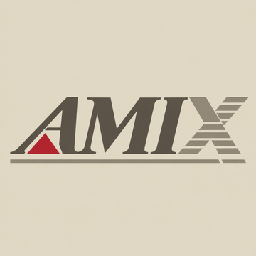

# amix-userland

Software for AMIX (Amiga UNIX System V Release 4), laid out like
[oi-userland](https://github.com/OpenIndiana/oi-userland): one directory per
component, grouped by category. It is developed on an A3000 with a Z3660.

## Two repositories

| Repository | Holds | Compiler |
| ---------- | ----- | -------- |
| amix-userland | Programs and libraries, as recipes | GCC 14 |
| [amix-gate](https://github.com/isoriano1968/amix-gate) | Kernel, drivers, what runs on the Z3660's ARM core | GCC 2.7.2.3, GCC for ARM |

The names follow Solaris: the gate is the system, userland is what is built on it.
Neither holds AMIX files, and nothing here is compiled: you bring your own AMIX and
build from source. Each package stands alone, declares what it needs, and installs
what a developer needs on the Amiga itself as well as what a user needs.

## Layout

    amix-userland/
      components/<category>/<name>/            one version of a package
      components/<category>/<name>-<version>/  several versions side by side
      make-rules/                              shared build rules
      templates/                               a new component's starting point
      tools/                                   helpers for the tree
      doc/                                     how things work

A component holds what it takes to build it, not the built result:

    <name>/
      Makefile        where the source comes from, version, configure and build
      <name>.license  the upstream licence
      patches/        the AMIX changes, numbered
      files/          files that are ours (drivers, scripts, config)
      <name>.manifest name, version, what it requires and provides

`make build` runs `tools/amix-requires` first: each `require` must be another
component, and what that component `provide`s must be in the sysroot. What is
missing is built from its component and installed there. How to make one:
**[doc/creating-a-package.md](doc/creating-a-package.md)**; how a port goes from
download to the Amiga, with a worked example:
**[doc/porting-howto.md](doc/porting-howto.md)**.

No binaries, and no game data or other third-party content that may not be
redistributed.

## Several versions

As in oi-userland, the version goes into the directory name once more than one
is kept, with the major and minor numbers only:

    components/shell/bash-44/
    components/shell/bash-52/
    components/runtime/python-27/
    components/runtime/python-311/
    components/x11/mesa-183/
    components/x11/mesa-31/
    components/library/sdl-2/

This holds for libraries as much as for programs. Each version is installed
under its own prefix (`/opt/<name>-<version>`), a program links against the
version it names in its Makefile, and one version is linked into
`/usr/local` as the default.

## Categories

| Category       | For                                  | Today's repos                                     |
| -------------- | ------------------------------------ | ------------------------------------------------- |
| `audio`        | sound and music                      | moved: libmikmod, pt2-clone                       |
| `desktop`      | desktop environments                 | moved: cde, cde-apps, motif |
| `developer`    | compilers and development tools      | moved: gcc-27, gcc-14, vscode, nedit, pkgconf |
| `demos`        | demos and intros                     | moved: amixintro, halloween, lamerintro                                  |
| `editor`       | editors                              | moved: vim                                        |
| `gnu`          | GNU tools, in `/usr/gnu` (gzip in `/usr/local`) | bison, diffutils, findutils, gawk, grep, gzip, m4, make, sed, tar, and the metapackage gnu-tools |
| `games`        | games and their engines              | moved: iortcw, ioquake3, quake                    |
| `graphics`     | 3D and images                        | moved: blender; fsv                               |
| `meta`         | sets of packages, as OpenIndiana's meta-packages | amix-dev |
| `library`      | general libraries                    | moved: freeglut, glu, lib060, libpng, openssl, ncurses, pth, sdl2, soft3d, tinygl, zlib; amixc99, amixstat, bzip2, zstd |
| `network`      | network tools                        | openssh, curl, wget, ca-certificates              |
| `multimedia`   | video                                | moved: ffmpeg                                     |
| `runtime`      | language runtimes                    | moved: python3                                    |
| `shell`        | shells                               | bash, in `/usr/gnu/bin`                                            |
| `sysutils`     | system tools                         | moved: amixtop, fileutils, terminfo; amix-pkgtools (amix-install, amix-stubs) |
| `x11`          | X server, libraries, GL              | moved: libxp, x11r6.3, mesa-31, mesa-183, mesa-demos, xzz9000                 |

Kernel drivers, the 68040/68060 port and the Z3660 core 1 programs are in
[amix-gate](https://github.com/isoriano1968/amix-gate); the Z3660 firmware fork
stays separate.

New here? **[Getting started](doc/getting-started.md)** covers the toolchains, building a
component and copying it to the Amiga. To add software, see
[doc/creating-a-package.md](doc/creating-a-package.md); to move a repository in, see
[doc/moving-a-repo.md](doc/moving-a-repo.md).

## Licence

Each component keeps its own upstream licence. What is ours is MIT.
